<picture>
  <source media="(prefers-color-scheme: dark)" srcset="./dark.svg">
  <source media="(prefers-color-scheme: light)" srcset="./light.svg">
  
</picture>

## About

Full-stack developer and Computer Engineering student at AIEM. I build web apps end to end: interfaces, APIs, auth and databases. I've worked on internship projects at CodeAlpha and at BridgeAura (Fluxatic Global).

## Featured projects

| Project | What it is |
| --- | --- |
| [Uritomo](https://github.com/MrDcodder/Mini_Social_Media_App_URITOMO) | Full-stack social media demo: Express/SQLite backend, JWT auth, profile onboarding, posts, search, messages, notifications and a Tailwind frontend |
| [E-Commerce Full Stack](https://github.com/MrDcodder/E-Commerce_Full_stack) | Basic full-stack store with product listings, cart, user authentication and order management, built for the CodeAlpha Internship Program |
| [Electronics E-commerce](https://github.com/MrDcodder/E-commerce_Site) | Mini project for skill development: an electronics e-commerce site, front end and back end |
| [BridgeAura Internship Project](https://github.com/MrDcodder/BridgeAura_Inernship_Project) | Internship project at BridgeAura by Fluxatic Global (TypeScript) |

## Stack

`TypeScript` `HTML` `CSS` `Express` `SQLite` `Tailwind CSS` `JWT`

## Connect

[GitHub](https://github.com/MrDcodder)
